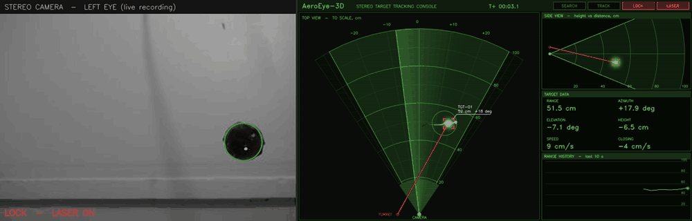
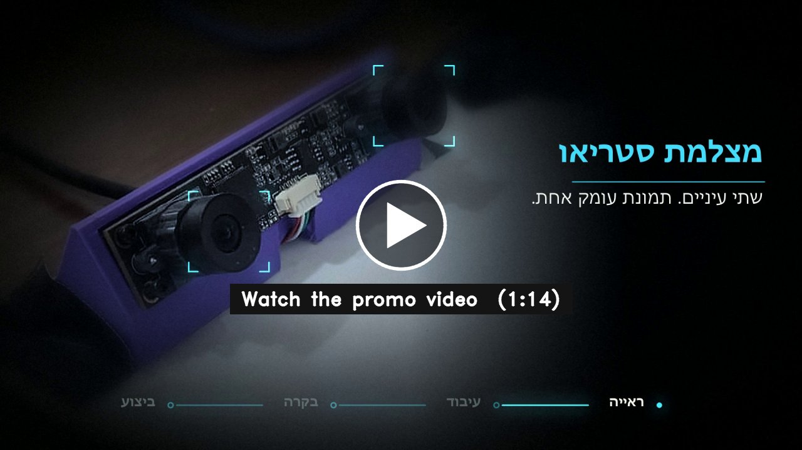
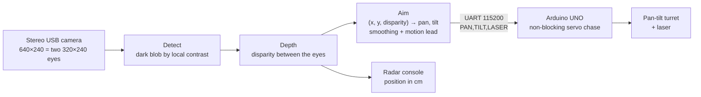
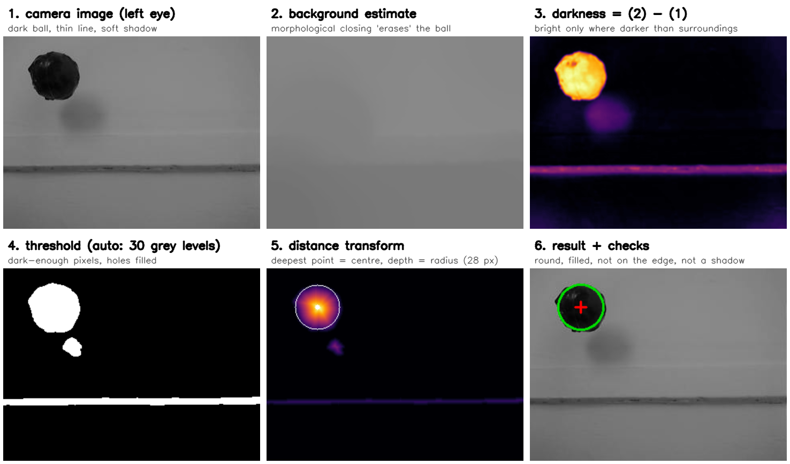
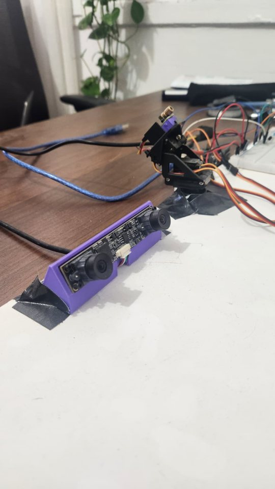
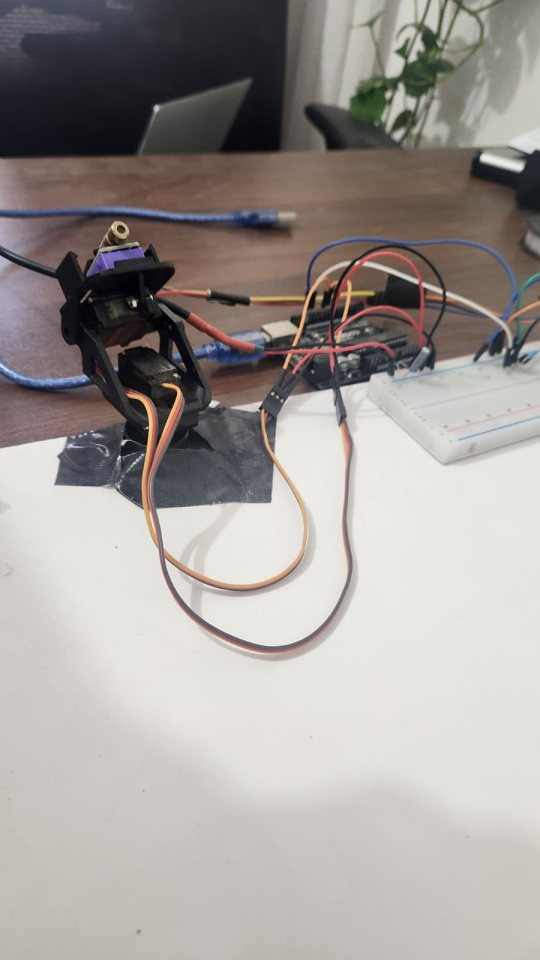
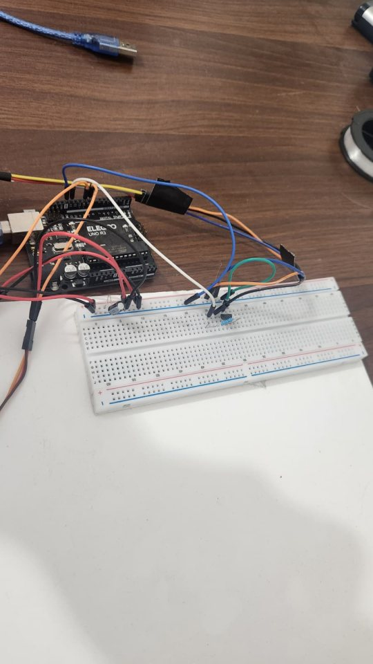
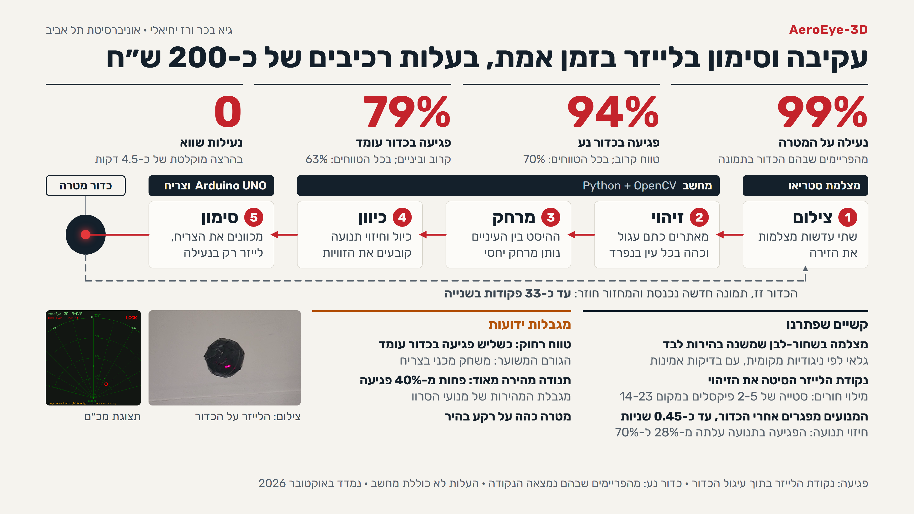

<div align="center">

# AeroEye-3D

**Real-time stereo-vision laser tracking turret**

A stereo camera finds a swinging ball, works out how far away it is from the shift between its two eyes,<br/>
and a pan-tilt turret keeps a laser on it, in real time, built from about ₪200 of parts.




<sub>A real recorded run, replayed: the left eye of the stereo camera with the detection (left), and the radar console showing where the ball is in centimetres and where the laser points (right). The bright dot on the ball is the laser.</sub>

</div>

---

## Results

| | Metric | Notes |
|---:|---|---|
| **99%** | Target lock | Frames in which the ball is in view |
| **94%** | Laser hits on a **moving** ball | Close range. 70% over all ranges |
| **79%** | Laser hits on a **stationary** ball | Close and mid range. 63% over all ranges |
| **0** | False locks | In a 4.5-minute recorded run |
| **≈33 Hz** | Aim updates | Frame → detection → servo command |

<sub>Hit = the laser dot lands inside the ball's outline. Measured October 2026. Parts cost excludes the PC.</sub>

<div align="center">
<a href="https://github.com/GuyBech/AeroEye-3D/releases/latest">

</a>
<br/><sub>74-second promo video (Hebrew), rendered with a custom Python + WebGL pipeline (<a href="promo/source">promo/source</a>)</sub>
</div>

---

## How it works



The work is split between two processors on purpose. The **PC** does the computer vision, which needs libraries and compute. The **microcontroller** generates the servo PWM, which needs hard timing that a desktop OS can't promise. The board acknowledges every command immediately and chases the latest target in the background (1° every 2 ms), so the vision loop never blocks waiting for a mechanical move to finish.

### 1. Detection: a dark ball on a monochrome camera



The camera is monochrome (its colour channels differ by 2 grey levels at most), and its auto-gain can't be turned off from OpenCV. Colour detection and fixed thresholds were never options. The final detector compares **each pixel with its own local background**: a morphological closing "erases" the ball, and subtracting the frame leaves only what is darker than its surroundings. An opening with a 29 px disk removes the thin rod the ball hangs from (about 10 px wide, against a ball of about 72 px). A distance transform then gives the centre and radius, and the candidate must pass checks for roundness, fill, image edge and shadow.

Three approaches were measured on the **same 15 recorded frames** before choosing:

| Approach | Measured roundness | Locks | Why it failed |
|---|---|---|---|
| MOG2 background subtraction | 0.15–0.35 | ~3% | Detects *change*: smears "where it was" and "where it is" into an ellipse, and loses the ball at the ends of the swing, where it stops |
| Difference from a reference image | n/a | ~6% | The reference goes stale as the camera's auto-gain drifts |
| **Local contrast (chosen)** | **0.73–0.87** | **44%** | n/a |

The detectors that lost are kept in the repo (`--ref`, `--shape`, `--motion`) because each one failed in an instructive way.

### 2. Depth from stereo

The same ball appears at slightly different x positions in the two eyes, and that **disparity** grows as the ball gets closer. The textbook relation `Z = K / d` didn't fit this camera. Measured over 5,395 frames, disparity against ball radius is a straight line (`d = 1.73·r − 15.8`) that doesn't pass through zero, which reveals a fixed disparity offset. The radar uses `Z = K / (d − d₀)`. The slope also gives the lens spacing (5.8 cm), which nothing had assumed. Distances in cm are good to about 15%.

### 3. Calibration: pixel + depth → servo angles

The camera and the laser sit in different places, so the angle needed depends on the target's distance as well as its pixel position (parallax). The mapping was built in two stages:

**A. Automatic board scan.** The turret swept a 14 × 12 grid of angles in front of a white board at 14 distances. At each pose it took one frame with the laser off and one with it on, and **frame differencing** found the dot in both eyes with no human in the loop: 1,804 raw points, 1,290 after filtering. Two detection bugs were found and fixed along the way. The laser body's glow was removed with a repetition filter. A ghost reflection from the cheap laser lens was handled by snapping to the brightest pixel in the "on" frame. The model is quadratic with a depth term:

```
pan  = a₁x + a₂y + a₃·disp + a₄xy + a₅x² + a₆y² + a₇      (same form for tilt)
```

**B. Calibration on the real target.** The turret **centres the laser on the ball by itself** (closed loop on the local Jacobian, gain 0.55) and records only once it has converged. The correction model was chosen by **leave-one-out cross-validation**, not by fit. A 7-parameter model scored 97% on its own data and 85% under cross-validation, which means it memorised rather than generalised.

| Model | LOO RMS | Pan | Tilt |
|---|---|---|---|
| Board calibration only | 4.97° | 3.08° | 3.89° |
| + constant offset | 3.33° | 3.17° | 1.02° |
| **+ linear correction in x, y, disparity** | **1.95°** | **1.62°** | **1.09°** |

### 4. Real-time tracking loop

Each frame: detect in both eyes → stereo sanity checks (disparity in range, rows agree) → calibrated angles → exponential smoothing (α = 0.7) → **velocity lead** (0.15 s pan, 0.30 s tilt) to cancel the end-to-end delay → send. If the ball briefly vanishes at the end of a swing, the turret **coasts** on its last aim for 0.8 s instead of dropping the lock. The laser is on **only while locked**. Motion prediction raised hits on a moving ball from **28% to 70%**.

### 5. Firmware

[`src/main.cpp`](src/main.cpp) is a single portable sketch that builds for **Arduino UNO** and **ESP32** (`#ifdef ARDUINO_ARCH_ESP32`, two PlatformIO environments). The protocol is one text line per command, `PAN,TILT,LASER\n`, answered at once with `OK …`. Targets are clamped to safe mechanical limits, and the laser defaults to off.

---

## Hardware

<p align="center">



</p>

| Part | Details |
|---|---|
| Controller | Arduino UNO R3 (Elegoo). ESP32 DevKit V1 is supported by the same firmware |
| Camera | USB stereo camera, monochrome, 640×240 side-by-side frame |
| Actuators | 2 × MG90S metal-gear servos on a pan-tilt bracket |
| Laser | KY-008 (650 nm), switched low-side by a 2N2222A with a 1 kΩ base resistor |
| Power | Servos and laser on an external 5 V supply, MCU on USB, **common ground** |
| Pins (UNO) | `D9` pan · `D10` tilt · `D13` laser (the on-board LED mirrors it) |

Full wiring: [`docs/WIRING.md`](docs/WIRING.md) (Hebrew).

---

## Development journey

The system was built **one verified stage at a time**: no stage was closed until it passed its own test, and every fault was isolated by testing parts on their own. The full log is in [`docs/LAB_REPORT.md`](docs/LAB_REPORT.md) and [`docs/BUILD_LOG.md`](docs/BUILD_LOG.md) (Hebrew).

| # | Stage | What went wrong → how it was solved |
|---|---|---|
| 1 | **MCU bring-up** (ESP32, serial echo) | The ESP32 toolchain failed on a Hebrew folder path → moved to an ASCII-only path |
| 2 | **Single servo** | Servo dead on the breadboard but fine when wired directly → the breadboard's power rail is split in the middle |
| 3 | **Pan + tilt** | Tilt silent: first a boot-strapping pin (GPIO12), then a wire one column off. Found with diagnostic firmware that mirrored the signal on several pins |
| 4 | **Laser through a transistor** | Three stacked faults: the module's `S` pin is an enable, the transistor's E/C pinout was reversed, and half the rail was dead. Isolated by bypassing one part at a time |
| 5 | **Camera + OpenCV** | The camera turned out to be a real stereo pair. A bright white wall beat the small flashlight target → a saturation-level threshold |
| 6 | **UART command link** | The board replied `OK` but the servo didn't move: an instant jump drew too much current, and an open-loop servo can't report failure → rate-limited, then fully **non-blocking** motion |
| 7 | **External 5 V supply** | Both servos moving together. A loose ground wire was found because tilt worked while pan didn't |
| 8 | **Automatic 3D calibration** | Board scan at 14 depths. Laser **glow** and a **ghost reflection** biased the whole system by degrees → repetition filter + snap-to-brightest |
| 9 | **ESP32 → Arduino UNO** | The ESP32 sat loose in the breadboard → switched boards, kept one portable firmware |
| 10 | **Flashlight → passive ball** | A flashlight swallows the laser dot. Three detectors were benchmarked on recorded frames, and local contrast won |
| 11 | **Calibration on the ball + cross-validation** | A constant +3.7° tilt bias was the signature of the turret having **physically moved**. Manual marking showed that "±18 px servo backlash" was really a measurement bug; the true scatter was 7 px |
| 12 | **Radar console, depth scale, latency** | Range in cm from disparity, end-to-end delay measured, motion lead tuned from data rather than guessed |
| 13 | **Promo video** | Rendered by a Python + WebGL pipeline from the project's own recordings |

**Lessons that carried over:**
- **An ACK is not proof of motion.** An open-loop servo will report success it didn't achieve.
- **Validate the measuring tool before trusting what it says about the system.** Manual marking overturned a "hardware limit" conclusion.
- **Separate causes before tuning.** Testing with the ball standing still showed a calibration problem, not a latency one, before any prediction was tuned.
- **Choose models by cross-validation, not by how well they fit.**

<details>
<summary><b>One-page project summary (Hebrew)</b></summary>
<br/>

<p><a href="docs/report/AeroEye-3D_executive_summary_he.pdf">PDF version</a></p>
</details>

---

## Repository structure

```
aeroeye-3d/
├── src/main.cpp              # Firmware: non-blocking UART servo + laser control (UNO / ESP32)
├── platformio.ini            # Two build environments: uno (active), esp32doit-devkit-v1
├── vision/                   # Everything that runs on the PC
│   ├── track_motion_3d.py    # ★ Main tracker: detect → depth → angles → UART
│   ├── detector_dark.py      # ★ Chosen detector: local-contrast dark blob
│   ├── radar.py              # ★ Radar console (position in cm, sound, history)
│   ├── radar_replay.py       #   Runs the console from a recording, no hardware
│   ├── stereo.py             #   Splits the frame into left / right eyes
│   ├── calib_ball.py         #   Calibration on the ball (auto-centring)
│   ├── fit_ball_calib.py     #   Model fitting with leave-one-out CV
│   ├── autocal3d.py          #   Automatic multi-depth board scan
│   ├── measure_depth.py      #   Depth scale (disparity → cm)
│   ├── measure_latency.py    #   End-to-end delay → motion-lead setting
│   ├── detector_*.py         #   Alternative detectors kept for comparison
│   ├── calib3d.json, aim_correction.json   # Active calibration data
│   ├── archive/              #   Earlier iterations of the code
│   └── debug_images/         #   Recorded runs (logs) and diagnostic images
├── scripts/                  # Double-click launchers (Windows)
├── promo/source/             # Promo-video pipeline (Python + WebGL)
└── docs/                     # Lab report, build log, how-to, wiring (Hebrew) + media
```

---

## Getting started

**Requirements:** Python 3.14, [PlatformIO](https://platformio.org/), the stereo camera, and the turret wired as above.

```bash
python -m venv .venv
.venv\Scripts\pip install -r requirements.txt

# flash the firmware (Arduino UNO on COM4)
pio run -e uno -t upload --upload-port COM4

# run the tracker: serial port, camera index
cd vision
..\.venv\Scripts\python.exe track_motion_3d.py COM4 1
```

**No hardware?** Replay a recorded session on the radar console:

```bash
cd vision
..\.venv\Scripts\python.exe radar_replay.py
```

On Windows you can also double-click the launchers in [`scripts/`](scripts): `run_tracking.bat`, `recalibrate.bat`, `radar_replay.bat`.

---

## Documentation (Hebrew)

| Document | Contents |
|---|---|
| [`HOWTO.md`](docs/HOWTO.md) | Operating guide: running, calibration, troubleshooting |
| [`LAB_REPORT.md`](docs/LAB_REPORT.md) | Lab report: every stage, measurement and fault |
| [`PROJECT_SUMMARY.md`](docs/PROJECT_SUMMARY.md) | Technical summary: architecture, calibration maths, tracking loop |
| [`BUILD_LOG.md`](docs/BUILD_LOG.md) | Build log with a verification gate for each stage |
| [`WIRING.md`](docs/WIRING.md) | Wiring, pin map, power architecture |
| [`MAP.md`](docs/MAP.md) | What every file and folder is |
| [`DEMO.md`](docs/DEMO.md) | Live-demo script |

---

## Known limitations

- **Long range:** only about a third of shots hit a stationary ball. Suspected cause: mechanical play in the turret.
- **Very fast swings:** under 40% hits, limited by servo speed.
- **Calibration is tied to the physical setup:** moving the camera or the turret requires recalibrating.
- Designed for a **dark target on a light background**.

---

<div align="center">

**Guy Becher · Raz Yechieli**<br/>
Hardware Lab project · School of Electrical and Computer Engineering · Tel Aviv University · 2026

</div>
